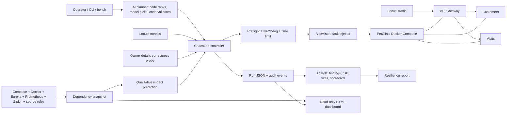

# Architecture and evidence flow

ChaosLab is a Python controller around a **local Docker Compose sandbox**. The dashboard reads saved JSON and cannot call the fault injector. An AI planner chooses the next experiment from a code-ranked shortlist and an analyst scores every run; code makes every decision that runs, scores or stops a test, and the optional language model only picks among validated options and writes explanations.

## Request behavior that matters

`GET /api/gateway/owners/{ownerId}` asks Customers for the owner and Visits for visit records. The Visits fallback can produce an owner response with missing visits and HTTP `200`. Current runs write a canary visit before injection, record expected visit IDs in the healthy baseline, and check their presence through fault and recovery. A service can recover while previously written visits remain lost; the result reports both facts. This keeps a successful status code from being mistaken for a successful user outcome.

## Data contracts

- `reports/dependency-map.json` is the versioned dependency snapshot. It joins source-backed feature rules with runtime observations and records provenance, verification state, and source timestamps. The `impact` command evaluates a selected failure against this snapshot without injection.
- `runs/<run-id>/result.json` records the selected fault, guardrails, baseline, timeline, semantic probes, captured prediction, outcome, recovery, and prediction comparison. `events.jsonl` is the action log. These local runs are ignored by Git.
- `demo/visits-failure.json` is a curated copy of one real run recorded before canary and data-loss classification were added. It retains the original outcome and measured timeline, removes individual visit IDs, and keeps representative correctness probes. It lets a fresh clone render an honest example without Docker.
- `reports/dashboard.html` is a standalone, generated read-only page. It selects the newest finished local run, falling back to the committed demo. It labels historical telemetry and any difference between the run's captured prediction snapshot and the current map.

## Safety boundary

Only containers carrying `chaoslab.target=true` are eligible. Before injection, the controller checks healthy traffic and a valid owner-details baseline. A single fault runs within parameter limits and a maximum duration. The watchdog samples error rate, p95 latency, throughput, and owner-data correctness, then reverts on sustained breaches. A kill switch can revert active faults; a separate dead-man's switch handles controller failure. The dashboard has no route to these controls. The live bench (`chaoslab bench`) is an operator console, not a report: like the CLI it can start one guarded `chaoslab run` and press the kill switch, and it accepts those requests only from its own page on this machine.

For setup and commands, see [operations](operations.md). For the recorded evidence, see the [demo guide](demo.md).
